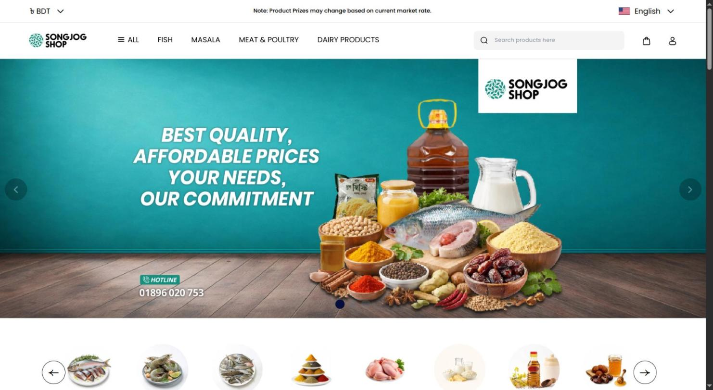
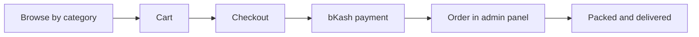

# Songjog Shop

[songjogshop.com](https://songjogshop.com) is Songjog's online grocery shop for fresh fish, dairy, spices, oil and other local produce, delivered in Dhaka. I set it up and designed it on Bagisto, the Laravel e-commerce framework.

## How an order moves

## What I did

- Set up the store on Bagisto and designed the storefront
- Organized the catalog into categories such as fish, masala, meat and poultry, and dairy
- Upgraded an open-source bKash payment gateway for Bagisto to the bKash API v2 and published it as [bagisto-bkash-v2](https://github.com/atiqursafayat/bagisto-bkash-v2)
- Now adding custom features on top of Bagisto

## Built with

Bagisto · Laravel · PHP · bKash API v2

## Status

Live at [songjogshop.com](https://songjogshop.com).
